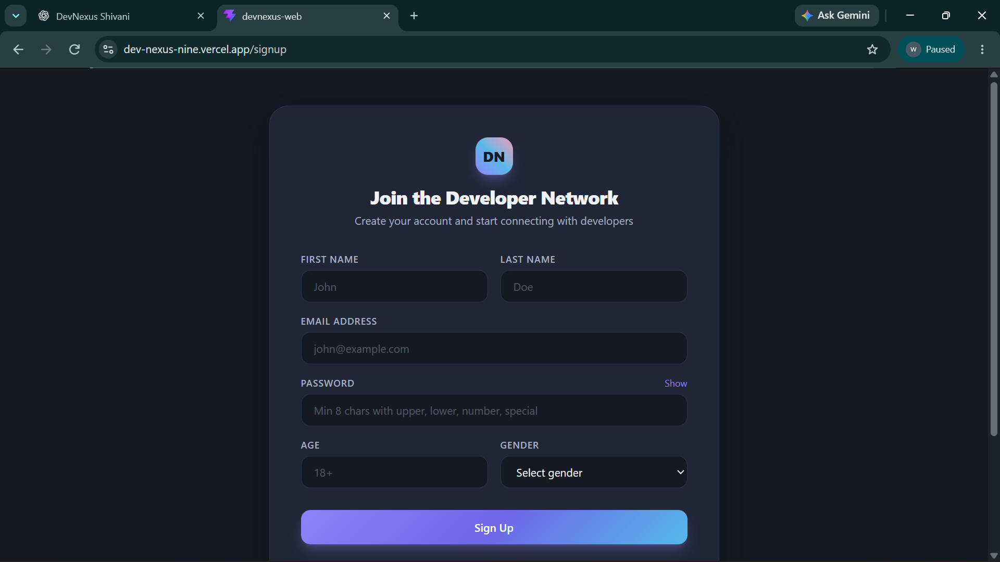
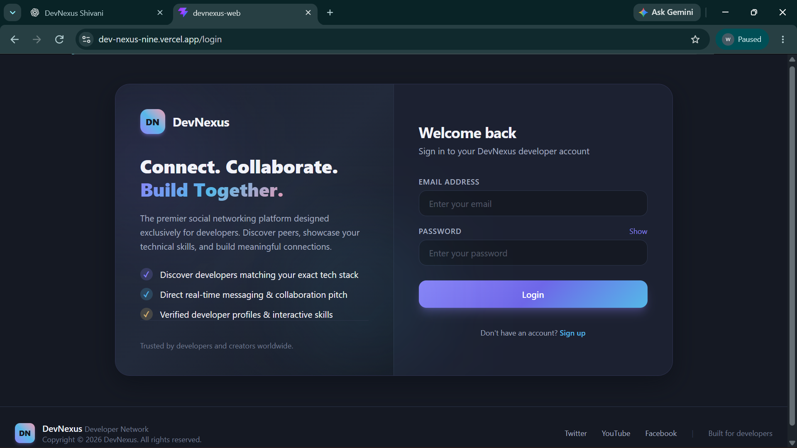
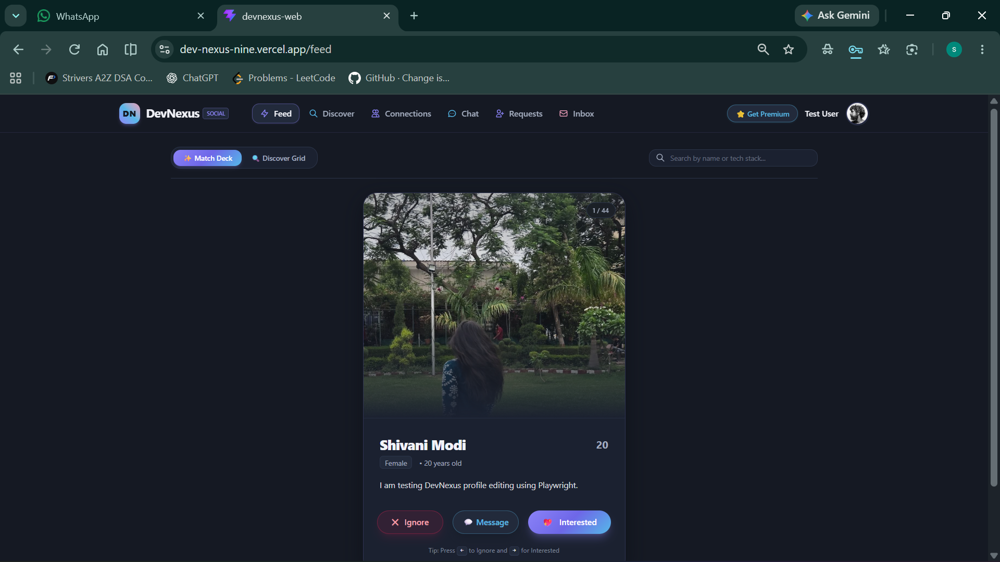
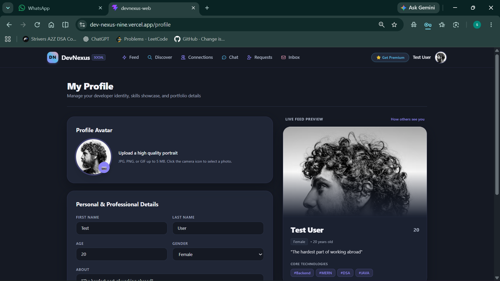
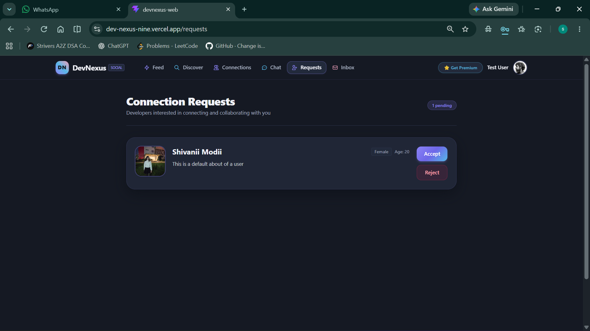
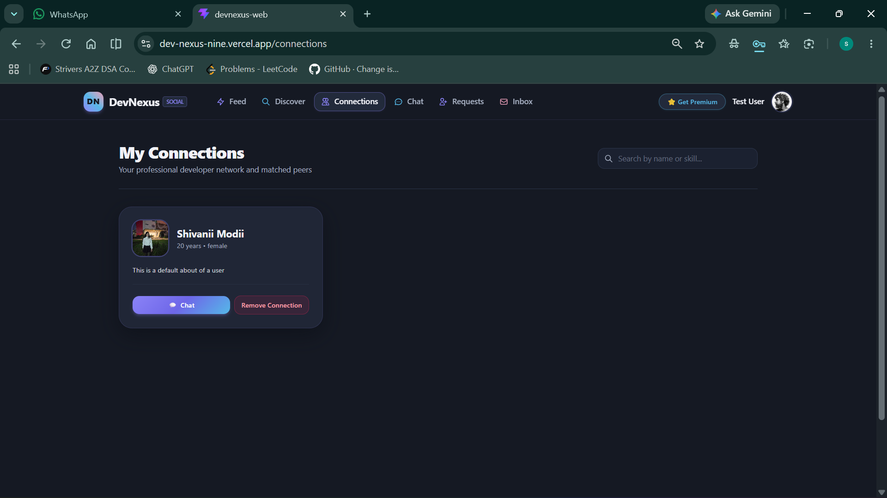
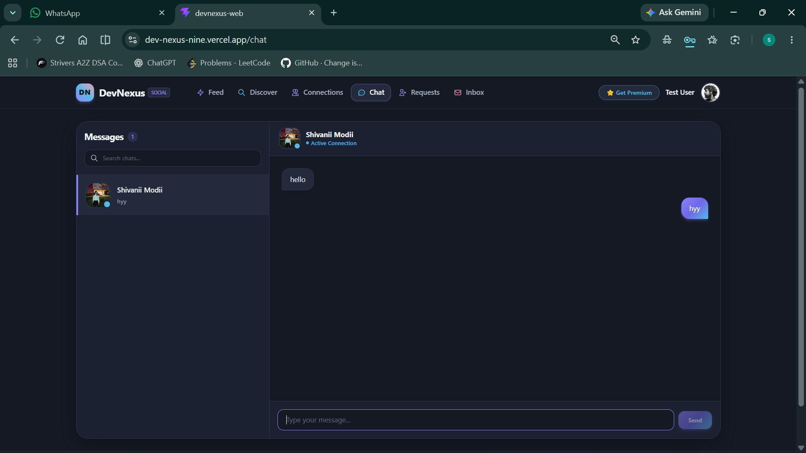
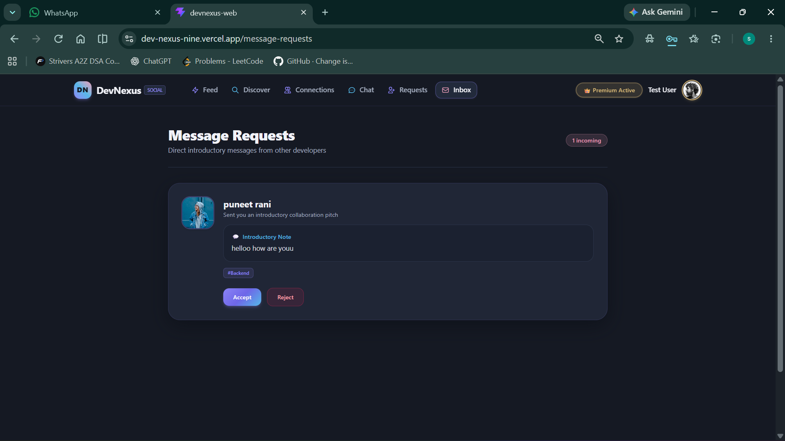
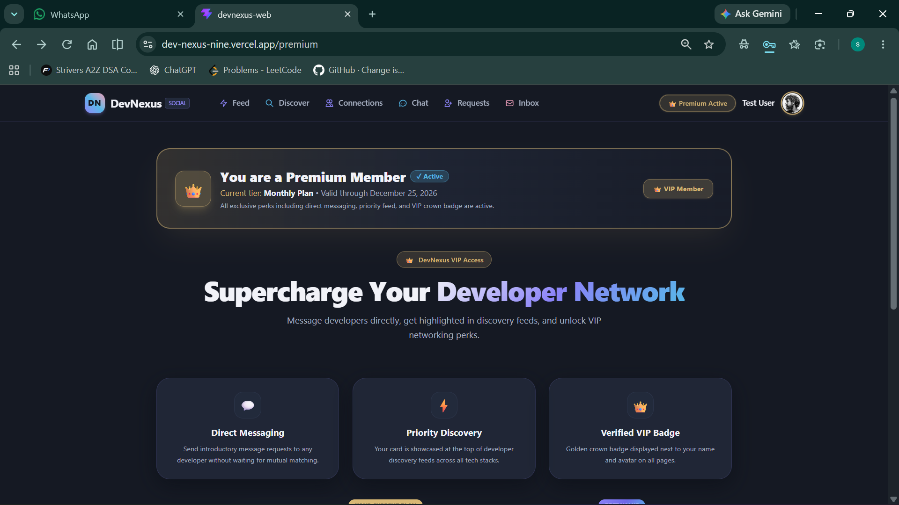

<div align="center">

# DevNexus

### Connect. Collaborate. Build Together.

A developer-focused networking platform to discover peers, showcase technical skills, build meaningful connections, and communicate in real time.

[](https://dev-nexus-nine.vercel.app)
[](https://dev-nexus-nine.vercel.app)
[](https://devnexus-backend-o64k.onrender.com)

</div>

---

## Overview

**DevNexus** is a full-stack MERN application designed to help developers connect with people who share similar technical interests. Users can create developer profiles, discover other members, send and manage connection requests, and communicate through real-time chat. The platform also includes a premium membership experience with additional networking features.

## Features

- **Authentication:** Registration and login with protected routes and persistent sessions.
- **Developer Discovery:** Explore developer profiles and search by name or technology stack.
- **Profile Management:** Update personal details, profile photos, professional information, and technical skills.
- **Connection Requests:** Send, accept, and reject requests.
- **Connections:** View accepted connections and start conversations.
- **Real-Time Messaging:** Chat with connected developers using Socket.IO.
- **Message Requests:** Send introductory messages and manage incoming requests.
- **Premium Membership:** Razorpay-powered membership flow with additional networking benefits.

## Screenshots

### Authentication

<table><tr><td width="50%"><p align="center"><strong>Sign Up</strong></p></td><td width="50%"><p align="center"><strong>Login</strong></p></td></tr></table>

### Developer Discovery

<p align="center"></p>

### Profile Management

<p align="center"></p>

### Networking

<table><tr><td width="50%"><p align="center"><strong>Connection Requests</strong></p></td><td width="50%"><p align="center"><strong>My Connections</strong></p></td></tr></table>

### Communication

<table><tr><td width="50%"><p align="center"><strong>Real-Time Chat</strong></p></td><td width="50%"><p align="center"><strong>Message Requests</strong></p></td></tr></table>

### Premium Membership

<p align="center"></p>

## Tech Stack

| Layer | Technologies |
|---|---|
| Frontend | React 19, Vite |
| Styling | Tailwind CSS v4, DaisyUI 5 |
| State Management | Redux Toolkit |
| API Communication | Axios |
| Backend | Node.js, Express.js |
| Database | MongoDB, Mongoose |
| Authentication | JWT, HTTP-only cookies |
| Real-Time Communication | Socket.IO |
| Image Storage | Cloudinary |
| Payments | Razorpay |
| Deployment | Vercel (frontend), Render (backend) |

## Project Structure

```text
DevNexus/
├── backend/
│   ├── src/
│   │   ├── config/
│   │   ├── middleware/
│   │   ├── models/
│   │   ├── routes/
│   │   ├── sockets/
│   │   ├── utils/
│   │   └── app.js
│   ├── .env.example
│   └── package.json
├── frontend/
│   ├── public/
│   ├── src/
│   │   ├── components/
│   │   ├── config/
│   │   ├── pages/
│   │   ├── redux/
│   │   └── utils/
│   ├── .env.example
│   └── package.json
├── docs/
│   └── screenshots/
└── README.md
```

## Run Locally

### Prerequisites

- Node.js and npm
- MongoDB (local instance or MongoDB Atlas)
- Cloudinary account for profile image uploads
- Razorpay account if you want to test the payment flow

### 1. Clone the repository

```bash
git clone https://github.com/shivanimxdi143/DevNexus.git
cd DevNexus
```

### 2. Set up the backend

```bash
cd backend
npm install
```

Create `backend/.env` using `backend/.env.example` as a guide. Add your own credentials:

```env
PORT=3000
NODE_ENV=development
MONGO_URI=your_mongodb_connection_string
JWT_SECRET=your_jwt_secret
FRONTEND_URL=http://localhost:5173
CLOUDINARY_CLOUD_NAME=your_cloudinary_cloud_name
CLOUDINARY_API_KEY=your_cloudinary_api_key
CLOUDINARY_API_SECRET=your_cloudinary_api_secret
RAZORPAY_KEY_ID=your_razorpay_key_id
RAZORPAY_KEY_SECRET=your_razorpay_key_secret
```

Start the backend:

```bash
npm run start
```

The backend runs on `http://localhost:3000` unless you configure another port.

### 3. Set up the frontend

Open a second terminal from the repository root:

```bash
cd frontend
npm install
```

Create `frontend/.env` with:

```env
VITE_API_URL=http://localhost:3000
```

Start the frontend:

```bash
npm run dev
```

Open the local Vite URL shown in your terminal (normally `http://localhost:5173`).

## Live Deployment

- **Frontend:** [https://dev-nexus-nine.vercel.app](https://dev-nexus-nine.vercel.app)
- **Backend:** [https://devnexus-backend-o64k.onrender.com](https://devnexus-backend-o64k.onrender.com)

Configure `VITE_API_URL` in Vercel and the backend environment variables in Render. Set the backend `FRONTEND_URL` to the deployed frontend origin.

> **Note:** The Render free instance may spin down after inactivity, so the first request after a period of inactivity can take longer.

## Security

- Never commit `.env` files or private API credentials.
- Use your own MongoDB, Cloudinary, and Razorpay credentials for local development.
- Use Razorpay test credentials when testing payments.
- Never expose JWT or payment secrets in frontend code.

## Author

**Shivani Modi**  
GitHub: [@shivanimxdi143](https://github.com/shivanimxdi143)  
Repository: [DevNexus](https://github.com/shivanimxdi143/DevNexus)

---

<div align="center">

**Built for developers, by developers.**

If you find this project interesting, consider giving the repository a ⭐.

</div>
